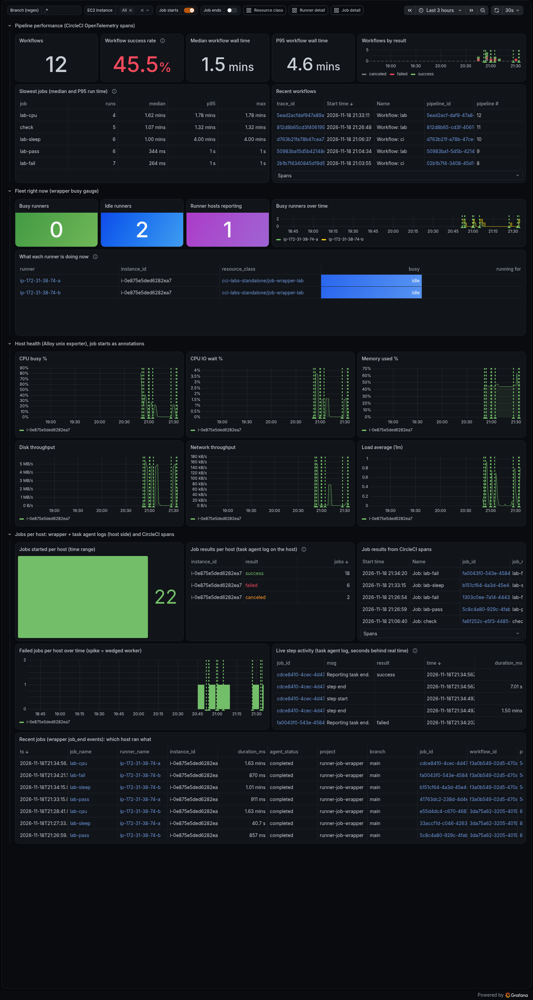
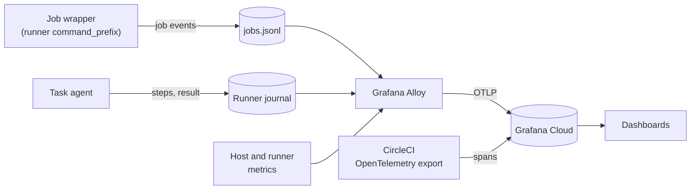
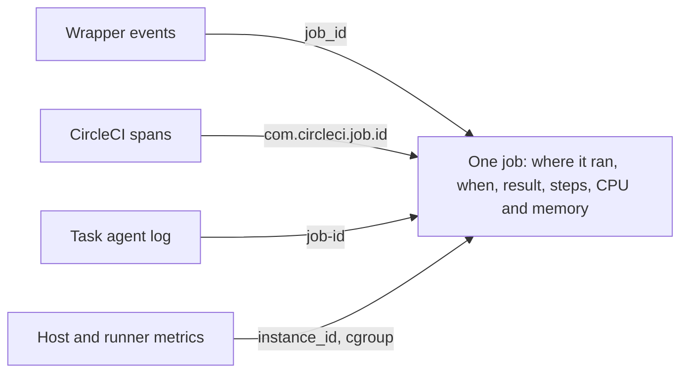

# CircleCI runner job wrapper: which job ran on which host

A small bash `command_prefix` wrapper for CircleCI machine runner that records which job ran on which host (EC2 instance, runner agent, resource class), with the CircleCI job, workflow and pipeline IDs and links, so you can join CircleCI OpenTelemetry spans with host metrics and logs in any observability backend.

[](https://dl.circleci.com/status-badge/redirect/gh/CircleCI-Labs/runner-job-wrapper/tree/main)
[](https://github.com/CircleCI-Labs/runner-job-wrapper/releases)
[](./LICENSE)
[](https://discuss.circleci.com/)

> **CircleCI Labs project.** Not an official CircleCI product and not supported by CircleCI support. Field engineers maintain it on a best-effort basis. See [Support](#support).

## Why use it

- **Host identity on every job.** CircleCI's OpenTelemetry job spans carry no runner or host identity. Every wrapper event adds the EC2 instance, runner name and resource class.
- **Joins on two keys.** `job_id` matches `com.circleci.job.id` on CircleCI spans, and `instance_id` matches your host metrics.
- **Links to CircleCI.** Events carry the job, workflow and pipeline IDs and URLs, so a dashboard row opens the job.
- **Never changes the job.** The task agent runs as a normal child. Stdin, signals and the exit status pass through, and a logging failure never fails a job.
- **No dependencies.** One bash 4 script: no daemon, no `jq`, no Python. About 6 ms per job.
- **Any backend.** The output is JSONL on disk. A tested Grafana Alloy example and an example Grafana dashboard are included, and the Datadog Agent is documented.

## Who it is for

Teams that run CircleCI machine runner on Linux (EC2 first) and want to know which host ran a job, or which job ran when a host misbehaved.

Use something else when:

- You use CircleCI hosted executors: they already show resource usage in the job.
- You use container runner or Kubernetes: the wrapper targets machine runner, and the container runner is not supported.
- You need CircleCI Server, Windows or macOS runners: these are not tested.
- CircleCI's built-in runner telemetry already carries what you need. If that ships, you may not need this project.

## Required and optional

Only the first group is required.

| | What | Notes |
|---|---|---|
| **Required** | `bin/circleci-job-wrapper` and a `command_prefix` in the runner config | Machine runner 3.1.11 or later, on Linux |
| **Required** | A log directory the runner user can write | Default `/var/log/circleci-job-wrapper` |
| **Recommended** | The boot-time host cache systemd unit | EC2 identity without a metadata call per job. IMDS must be enabled, IMDSv2 works |
| **Recommended** | The logrotate config | Daily rotation of `jobs.jsonl` |
| **Recommended** | `/etc/circleci-job-wrapper/wrapper.env` with `CCI_RESOURCE_CLASS` | The runner does not tell the wrapper its resource class |
| **Optional** | CircleCI org OpenTelemetry export | Spans for job and step timing and the job result |
| **Optional** | Prometheus busy gauge (`CCI_JOBLOG_PROM_DIR`) | A live busy or idle view per runner |
| **Optional** | HTTP sink (`CCI_JOBLOG_HTTP_URL`) | POST every event to an endpoint |
| **Optional** | A shipper: the Grafana Alloy example, the Datadog Agent, Vector, Fluent Bit and others | Moves `jobs.jsonl` to your backend |
| **Optional, experimental** | The task-agent journal pipeline | Live step progress and the job result per host. The internal log format may change |
| **Optional** | The example Grafana dashboards | Need the Alloy data in Grafana Cloud or similar |

## Quickstart

**For the full path (wrapper, CircleCI OpenTelemetry export, Alloy and dashboards), follow [Set it up end to end](https://circleci-labs.github.io/runner-job-wrapper/docs/get-started/set-up-end-to-end/).** The steps below are the wrapper alone.

1. Install the wrapper and create the directories. The runner user must be able to write both.

   ```sh
   sudo install -m 0755 bin/circleci-job-wrapper /usr/local/bin/circleci-job-wrapper
   sudo install -d -m 0775 -o root -g circleci /var/log/circleci-job-wrapper
   ```

2. Install the boot-time host cache (recommended).

   ```sh
   sudo install -m 0644 systemd/circleci-job-wrapper-hostcache.service /etc/systemd/system/
   sudo systemctl daemon-reload && sudo systemctl enable --now circleci-job-wrapper-hostcache.service
   ```

3. Set the resource class in `/etc/circleci-job-wrapper/wrapper.env` (recommended):

   ```sh
   CCI_RESOURCE_CLASS=my-org/linux-large
   ```

4. Add the prefix to `/etc/circleci-runner/circleci-runner-config.yaml`:

   ```yaml
   runner:
     command_prefix: ["/usr/local/bin/circleci-job-wrapper"]
   ```

5. Restart the runner, run a job, and read the result:

   ```sh
   tail -n2 /var/log/circleci-job-wrapper/jobs.jsonl
   ```

Replace `circleci` with the account and group your runner runs as. [Install](https://circleci-labs.github.io/runner-job-wrapper/docs/get-started/install/) has log rotation and the multi-runner setup.

## What you get



The fleet dashboard, with pipeline performance from CircleCI spans, the live fleet, host health and recent jobs. A [job-detail dashboard](https://circleci-labs.github.io/runner-job-wrapper/docs/dashboards/example-dashboard/) joins one job's trace, steps, host and CPU.

## How it fits together





`agent_status` in the events describes the agent process, not the job result. Take the result from the CircleCI span (`com.circleci.job.status`). See [How it works](https://circleci-labs.github.io/runner-job-wrapper/docs/reference/how-it-works/).

## What is tested

The project is pre-release (0.x). If a page claims more than this table shows, please open an issue.

| What | Status | How it is checked |
|---|---|---|
| Wrapper core | Tested | A real machine runner 3.1.14 on an Ubuntu 24.04 EC2 host with two runner agents. 62 bats tests, shellcheck clean |
| Grafana Alloy example | Tested | Shipped to Grafana Cloud |
| Example Grafana dashboards | Tested | Built from the Alloy data |
| Per-job CPU and memory (cAdvisor) | Tested | Alloy cAdvisor block, joined on the wrapper's `cgroup` |
| Pipeline performance panels | Tested | Grafana Cloud Tempo with TraceQL metrics |
| Task-agent journal pipeline | Experimental | Reads an internal log format that may change between runner versions |
| Datadog Agent | Documented, not tested | The steps follow Datadog's documentation |
| CircleCI Server, Windows, macOS, container runner | Not tested, not supported | Machine runner on Linux only |

## Documentation

Read the docs at [circleci-labs.github.io/runner-job-wrapper](https://circleci-labs.github.io/runner-job-wrapper/).

| You want to | Read |
|---|---|
| Set it all up | [Set it up end to end](https://circleci-labs.github.io/runner-job-wrapper/docs/get-started/set-up-end-to-end/) |
| Install the wrapper only | [Install](https://circleci-labs.github.io/runner-job-wrapper/docs/get-started/install/) |
| Change a setting | [Configuration](https://circleci-labs.github.io/runner-job-wrapper/docs/configure/configuration/) |
| Know what is logged | [Event schema](https://circleci-labs.github.io/runner-job-wrapper/docs/reference/event-schema/) |
| Join it with CircleCI spans | [Join data with CircleCI OpenTelemetry](https://circleci-labs.github.io/runner-job-wrapper/docs/send-the-data/join-with-opentelemetry/) |
| Ship the data | [Alloy](https://circleci-labs.github.io/runner-job-wrapper/docs/send-the-data/ship-with-alloy/), [Datadog Agent](https://circleci-labs.github.io/runner-job-wrapper/docs/send-the-data/ship-with-datadog/) |
| See the dashboards | [Example Grafana dashboards](https://circleci-labs.github.io/runner-job-wrapper/docs/dashboards/example-dashboard/) |
| Judge the risk | [Security](https://circleci-labs.github.io/runner-job-wrapper/docs/configure/security/) |
| Fix a problem | [Troubleshooting](https://circleci-labs.github.io/runner-job-wrapper/docs/operate/troubleshooting/), [FAQ](https://circleci-labs.github.io/runner-job-wrapper/docs/faq/) |

## Support

This is a CircleCI Labs project: a solution that field engineers at CircleCI built with customers. It is **not** an official CircleCI product, and CircleCI support does not cover it. Field engineers handle issues on a best-effort basis, without an SLA.

- Open a [GitHub issue](https://github.com/CircleCI-Labs/runner-job-wrapper/issues) for a bug or a feature request. Search [Troubleshooting](https://circleci-labs.github.io/runner-job-wrapper/docs/operate/troubleshooting/) first.
- Ask the community on [CircleCI Discuss](https://discuss.circleci.com/).
- Problems with the CircleCI platform or the runner agent go to [CircleCI support](https://support.circleci.com/hc/en-us).
- To report a security vulnerability, read [SECURITY.md](SECURITY.md).

To contribute, read [CONTRIBUTING.md](CONTRIBUTING.md).

## License

MIT. Refer to [LICENSE](./LICENSE).
