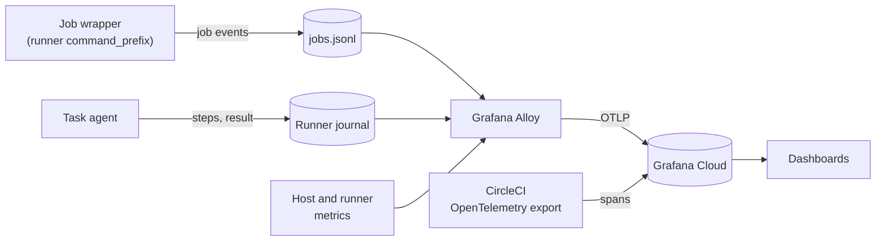

This is the one install path. It takes you from nothing to a dashboard where you pick a CircleCI job and see its trace, its steps, the host it ran on and the CPU it used. Do the stages in order. Each stage says why you do it, what to do, and how to check that it worked before you go on.

Stages 1 to 3 are the wrapper alone, and are enough to get host identity on every job. Stages 4 to 7 add CircleCI spans, a shipper and the dashboards. For several runners on one host, upgrades and removal, see [Several runners, upgrades and removal]().



> [!NOTE]
> This is a CircleCI Labs project, not an official CircleCI product. Pages mark what is tested and what is not.

### What gets installed

| Stage | What | Where | Needed for |
|---|---|---|---|
| 2 | `circleci-job-wrapper` | `/usr/local/bin/` | Everything |
| 2 | Log directory | `/var/log/circleci-job-wrapper/` | Everything |
| 2 | Host cache unit | `/etc/systemd/system/circleci-job-wrapper-hostcache.service` | EC2 identity without a metadata call per job |
| 2 | Log rotation | `/etc/logrotate.d/circleci-job-wrapper` | Daily rotation of `jobs.jsonl` |
| 2 | Operator file | `/etc/circleci-job-wrapper/wrapper.env` | Resource class, busy gauge |
| 3 | `command_prefix` line | `/etc/circleci-runner/circleci-runner-config.yaml` | Turns the wrapper on |
| 4 | OpenTelemetry exporter | CircleCI organization settings | Job result, steps, timing |
| 5 | Grafana Alloy config | `/etc/alloy/config.alloy` | Shipping data to your backend |
| 6 | Dashboards | Grafana | Seeing it all |

## 1. Prerequisites

**Why:** the wrapper needs a modern machine runner and a few standard tools, and you need the rights to finish stages 4 to 7. Finding a gap now is cheaper than finding it in stage 5.

**Do:** confirm you have all of these.

- A CircleCI **machine runner 3.1.11 or later on Linux**. Tested with 3.1.14 on Ubuntu 24.04.
- **Organization admin** rights in CircleCI, to add an OpenTelemetry exporter (stage 4).
- On EC2, the **instance metadata service (IMDS) enabled**. IMDSv2 works. Off EC2 the EC2 fields stay empty and nothing else changes.
- `bash` 4 or later, `curl`, and shell access with `sudo` to the runner host.
- For stages 4 to 7: a Grafana Cloud stack (or another OTLP backend) and a Grafana access token.

**Check 1a: the runner is installed and running.** This proves the runner agent the wrapper will wrap exists, is up, and is a supported version. On the runner host:

```sh
systemctl is-active circleci-runner
circleci-runner --version
```

Expected output:

```text
active
3.1.14
```

Any version from 3.1.11 up is fine.

**If it fails:** if the service is not `active` or the version is older, see [Troubleshooting]() and upgrade the runner first. If your unit has another name, use that name here and in later stages.

**Check 1b: the host can reach the EC2 metadata service.** This proves the wrapper can fill `instance_id` and `instance_type` on every event. On the runner host:

```sh
# IMDSv2: ask for a short-lived token, then use it
TOKEN=$(curl -s -X PUT \
  -H 'X-aws-ec2-metadata-token-ttl-seconds: 60' \
  http://169.254.169.254/latest/api/token)
curl -s -H "X-aws-ec2-metadata-token: $TOKEN" \
  http://169.254.169.254/latest/meta-data/instance-id
```

Expected output:

```text
i-0123456789abcdef0
```

Off EC2 you can skip this check: the EC2 fields stay empty and nothing else changes.

**If it fails:** an empty reply usually means IMDS is disabled or the hop limit is too low for your setup, see [EC2 fields are empty]().

**Check 1c: the tools are present.** This proves the wrapper's only dependencies exist. On the runner host:

```sh
bash --version | head -1
curl --version | head -1
```

Expected output:

```text
GNU bash, version 5.2.21(1)-release (x86_64-pc-linux-gnu)
curl 8.5.0 (x86_64-pc-linux-gnu) libcurl/8.5.0 OpenSSL/3.0.13
```

Any bash 4 or later passes.

**If it fails:** install `bash` 4 or later and `curl` with your package manager.

## 2. Install the wrapper

**Why:** this puts the wrapper script, its log directory and its host cache on the host, so that a job can be recorded.

**Do:** on every host that runs a runner agent, from a checkout of this repository. Replace `circleci` with the account and group your runner runs as.

On the runner host:

```sh
# the wrapper
sudo install -m 0755 bin/circleci-job-wrapper \
  /usr/local/bin/circleci-job-wrapper
# the log directory: the runner user must be able to write it
sudo install -d -m 0775 -o root -g circleci \
  /var/log/circleci-job-wrapper

# boot-time host cache (EC2 identity without a call per job)
sudo install -m 0644 \
  systemd/circleci-job-wrapper-hostcache.service \
  /etc/systemd/system/
sudo systemctl daemon-reload
sudo systemctl enable --now \
  circleci-job-wrapper-hostcache.service

# daily log rotation
sudo install -m 0644 logrotate/circleci-job-wrapper \
  /etc/logrotate.d/circleci-job-wrapper
```

Then write the operator file. It is parsed, never sourced. On the runner host:

```sh
sudo install -d /etc/circleci-job-wrapper
sudo tee /etc/circleci-job-wrapper/wrapper.env >/dev/null <<'ENV'
CCI_RESOURCE_CLASS=my-org/linux-large
CCI_JOBLOG_PROM_DIR=/run/circleci-job-wrapper/prom
CCI_JOBLOG_PROM_JOB_ID=1
ENV
```

- `CCI_RESOURCE_CLASS` is your resource class. The runner does not tell the wrapper, so set it here.
- `CCI_JOBLOG_PROM_DIR` turns on the Prometheus busy gauge (a live busy or idle view per runner). Optional, but the fleet dashboard uses it.
- `CCI_JOBLOG_PROM_JOB_ID=1` adds `job_id` and `workflow_id` labels to the gauge, one series per job. Fine for small fleets. Optional.

**Check 2a: the host cache is running and holds the instance ID.** This proves later jobs get EC2 identity from a file instead of a metadata call. On the runner host:

```sh
systemctl is-active circleci-job-wrapper-hostcache.service
grep instance_id /run/circleci-job-wrapper/host.env
```

Expected output:

```text
active
instance_id=i-0123456789abcdef0
```

**If it fails:** see [EC2 fields are empty](). Off EC2, `active` alone is enough.

**Check 2b: the wrapper script parses.** This proves the copy on disk is intact. On the runner host:

```sh
bash -n /usr/local/bin/circleci-job-wrapper && echo ok
```

Expected output:

```text
ok
```

**If it fails:** install the script again from the checkout. Settings are in [Configuration]().

## 3. Configure the runner

**Why:** the runner only calls the wrapper once it is set as its `command_prefix`. After this, every job writes a `job_start` and a `job_end` event.

**Do:** add the prefix to `/etc/circleci-runner/circleci-runner-config.yaml` on the runner host:

```yaml
runner:
  command_prefix: ["/usr/local/bin/circleci-job-wrapper"]
```

Restart the runner. On the runner host:

```sh
sudo systemctl restart circleci-runner
```

Then run any job on it. In the CircleCI web app, rerun a workflow that uses this resource class.

**Check:** this proves the runner called the wrapper for your job and that the wrapper found the host and the resource class. After the job ends, on the runner host:

```sh
# the last two events, with the fields that matter
tail -n2 /var/log/circleci-job-wrapper/jobs.jsonl |
  jq -c '{event,job_id,trace_id,runner_name,
          instance_id,resource_class,agent_status}'
```

Expected output (one line per event, wrapped here):

```text
{"event":"job_start","job_id":"5b1e0c1a-0000-4000-8000-000000000001",
 "trace_id":"9f8e7d6c5b4a39281706f5e4d3c2b1a0",
 "runner_name":"runner-a","instance_id":"i-0123456789abcdef0",
 "resource_class":"my-org/linux-large","agent_status":""}
{"event":"job_end","job_id":"5b1e0c1a-0000-4000-8000-000000000001",
 "trace_id":"9f8e7d6c5b4a39281706f5e4d3c2b1a0",
 "runner_name":"runner-a","instance_id":"i-0123456789abcdef0",
 "resource_class":"my-org/linux-large","agent_status":"completed"}
```

Both events are present, `job_id` is a UUID, and `instance_id` and `resource_class` are filled.

**If it fails:** if the file is empty or missing, see [jobs.jsonl is missing or empty](). If `instance_id` is empty, see [EC2 fields are empty]().

## 4. Turn on CircleCI's OpenTelemetry export

**Why:** the wrapper knows the host. CircleCI knows the job result, the steps and their timing. You get those as OpenTelemetry spans, from an exporter you add once per organization.

**Do:** add the exporter in the CircleCI web app (option A) or with the API (option B). It needs organization admin rights, and CircleCI supports up to 5 exporters per organization. Spans are sent when each job finishes.

If your collector restricts source IPs, allow CircleCI's core IPs. List them with `dig core.knownips.circleci.com`. Grafana Cloud needs no allow-list.

Official documentation: [OpenTelemetry integration](https://circleci.com/docs/guides/integration/open-telemetry-integration/) and the [API reference](https://circleci.com/docs/api/v2/#tag/OTel).

### Grafana Cloud values

| Setting | Value |
|---|---|
| Endpoint | `https://otlp-gateway-<region>.grafana.net/otlp/v1/traces` |
| Protocol | `http` |
| Header | `Authorization: Basic <base64 of instance-id:token>` |

On your workstation, build the header value:

```sh
printf '%s' '<instance-id>:<token>' | base64 -w0
```

> [!NOTE]
> `<region>` is the region of your **stack**. Take it from your data source URLs or from the OTLP tile of your stack. It is not necessarily the region embedded in the token.

### Option A: the CircleCI web app

In the CircleCI web app:

1. Open **Organization settings**, then **OpenTelemetry Configuration**.
2. Choose **Add exporter**.
3. Pick the protocol (`http`), enter the endpoint, and add the header.
4. Save.

### Option B: the API

Use an organization admin personal API token. On your workstation:

```sh
curl -sS -X POST https://circleci.com/api/v2/otel/exporters \
  -H "Circle-Token: $CIRCLECI_TOKEN" \
  -H 'Content-Type: application/json' \
  -d '{
    "org_id": "<your-org-id>",
    "endpoint": "https://otlp-gateway-<region>.grafana.net/otlp/v1/traces",
    "protocol": "http",
    "headers": {"Authorization": "Basic <base64 of instance-id:token>"}
  }'
```

### Datadog and other OTLP backends

Any backend that takes OTLP over HTTP works the same way: use its OTLP traces endpoint, protocol `http`, and the header it documents for authentication. For Datadog, that means an Agent or Collector that accepts OTLP, with its API key header. This is not tested here.

### What spans you get

| Span | What it covers |
|---|---|
| pipeline | The pipeline run |
| workflow | One workflow of the pipeline |
| job | One job |
| task | The task that executes the job |
| step | One step, named `Step: <name>`, with its duration, its result (`com.circleci.task.result`) and its exit code (`com.circleci.step.exit_code`) |

Attributes you will use:

- `com.circleci.job.id`: equals the wrapper's `job_id`. This is the join key.
- `com.circleci.job.status`: the job result.
- `com.circleci.resource.class`: the resource class.
- `vcs.ref.head.name`: the branch.
- The **trace ID** is the pipeline ID without dashes. It equals the wrapper's `trace_id`.

The spans carry **no CPU or memory and no host identity**. The wrapper adds the host and the job's CPU time, and the shipper in stage 5 adds host and cgroup metrics.

**Check:** this proves CircleCI is exporting spans, that your backend accepts them, and that the join key reaches Tempo. Run a job on the runner and wait for it to finish. Then in the Grafana web app, open **Explore**, pick your Tempo data source and run this TraceQL query:

```text
{ span.com.circleci.job.id != "" }
```

Expected output: a list of traces, one per job, such as:

```text
Trace ID                          Start time           Name
9f8e7d6c5b4a39281706f5e4d3c2b1a0  2026-11-18 20:31:55  workflow build
```

Open one: it has a `job` span whose `com.circleci.job.id` equals the `job_id` you saw in stage 3.

**If it fails:** re-check the stack region and the header, and the exporter list in **OpenTelemetry Configuration**. Spans can take a minute to appear. See [Join data with CircleCI OpenTelemetry]().

## 5. Install and configure the shipper

**Why:** the shipper moves `jobs.jsonl`, host metrics and per-job CPU and memory to your backend. This guide uses Grafana Alloy, the tested example. The Datadog Agent is [documented but not tested]().

**Do:** install Alloy by following Grafana's instructions, then configure it. On the runner host:

```sh
# env file of the alloy service, for example /etc/default/alloy
sudo tee -a /etc/default/alloy >/dev/null <<'ENV'
OTLP_ENDPOINT=https://otlp-gateway-<region>.grafana.net/otlp
OTLP_USERNAME=<instance-id>
OTLP_PASSWORD=<access-token>
EC2_INSTANCE_ID=<this host's instance id>
ENV
sudo chmod 0640 /etc/default/alloy

# let alloy read the log, the textfile directory, the journal
sudo usermod -aG circleci,systemd-journal alloy

sudo install -m 0644 examples/alloy/config.alloy \
  /etc/alloy/config.alloy
sudo systemctl restart alloy
```

Replace `circleci` with the runner's group. The endpoint here has no `/v1/traces`: Alloy exports logs and metrics, not traces. Never commit the token.

What each block of `examples/alloy/config.alloy` does:

1. **Wrapper events.** Tails `jobs.jsonl`, promotes `event`, `resource_class`, `runner` and `instance_id` to labels and sends the lines as OTLP logs.
2. **Task-agent journal (optional, experimental).** Keeps four log messages from the runner units for live step progress and the host-side job result.
3. **Host metrics.** `prometheus.exporter.unix` for CPU, memory, disk and network, plus the busy gauge textfile.
4. **cAdvisor block.** `prometheus.exporter.cadvisor` reads cgroup CPU and memory. A relabel rule keeps only the `/system.slice/circleci-runner*.service` cgroups and a few series. Each runner agent runs one job at a time, so its service cgroup is per-job CPU and memory over time. The wrapper's `cgroup` field joins to it.
5. **EC2 identity.** `resourcedetection` sets `host.id`, and a transform copies it into an `instance_id` attribute on metrics.
6. **Export.** OTLP over HTTP with basic auth.

**Check 5a: Alloy runs without errors.** This proves the config loads and the shipper is running. On the runner host:

```sh
sudo systemctl is-active alloy
sudo journalctl -u alloy -n 20 --no-pager |
  grep -i error || echo "no errors"
```

Expected output:

```text
active
no errors
```

**If it fails:** a permission error means `alloy` is not yet in the runner group, see [Alloy cannot read the log or the journal](). A 401 means the user or token in `/etc/default/alloy` is wrong.

**Check 5b: your backend receives the logs and the metrics.** This proves data arrives, not only that Alloy runs. In the Grafana web app, open **Explore**, pick the Loki data source and run:

```text
{service_name="circleci-job-wrapper"}
```

Expected output: log lines, one per job event, such as `{"schema":1,"event":"job_end", ...}`. Then pick the Prometheus data source and run:

```text
circleci_runner_busy
```

Expected output: one series per runner:

```text
circleci_runner_busy{runner="runner-a",
  instance_id="i-0123456789abcdef0"}  0
```

`container_cpu_usage_seconds_total{cgroup=~"/system.slice/circleci-runner.*"}` should return series too.

**If it fails:** nothing in Loki means Alloy cannot read the log. Nothing for `circleci_runner_busy` means `CCI_JOBLOG_PROM_DIR` is unset (stage 2). See [Ship with Grafana Alloy]() and [Troubleshooting]().

## 6. Import the dashboards

**Why:** the dashboards turn the events, spans and metrics into the fleet, job, runner and resource class views.

**Do:** find the UIDs of your data sources in the Grafana web app, under **Connections, Data sources** (the UID is in the URL). Then generate the dashboard JSON. On your workstation, from a checkout of this repository:

```sh
python3 examples/grafana/build_dashboard.py \
  --prom <prom-uid> --loki <loki-uid> --tempo <tempo-uid> \
  > dashboard.json
python3 examples/grafana/build_job_dashboard.py \
  --prom <prom-uid> --loki <loki-uid> --tempo <tempo-uid> \
  > job-dashboard.json
```

For CircleCI Server add `--app-url https://<your-circleci-host>` so links open your installation.

Import them either way:

- **In the Grafana web app:** Dashboards, New, Import, upload each JSON file.
- **With the API,** on your workstation:

  ```sh
  jq -n --slurpfile d dashboard.json \
    '{dashboard: $d[0], overwrite: true}' |
    curl -sS -X POST "$GRAFANA_URL/api/dashboards/db" \
      -H "Authorization: Bearer $GRAFANA_TOKEN" \
      -H 'Content-Type: application/json' -d @-
  ```

  Repeat for `job-dashboard.json`.

The runner detail and resource class dashboards are generated the same way, see the [dashboards page]().

**Check:** this proves the dashboards import and can read your data. In the Grafana web app, open the **CircleCI runner fleet** dashboard and look at the **Fleet right now** row.

Expected output: the dashboard opens, and the row shows your runners as busy or idle, with a table of what each is running now. The [tour]() shows what it looks like.

**If it fails:** a "No data" row means a data source UID is wrong or stage 5 is not shipping yet. Re-run the builder with the right UIDs, and see [Troubleshooting]().

## 7. Verify the join

**Why:** this proves the three sources meet for one job: the wrapper (host), CircleCI spans (result and steps) and the shipper (CPU and memory).

**Do:** in the Grafana web app:

1. On the fleet dashboard, open **Recent jobs** and pick a job.
2. Click **Drill into this job**. The job-detail dashboard opens, already filtered to that job.

**Check:** confirm you see the following. Each item matches an image in the [tour](): the first two are in the job trace image (4), the last two in the steps and resources image (5).

- **Where and when it ran**: the instance, runner, resource class and cgroup, from the wrapper.
- **The trace**: pipeline, workflow, job and steps, from CircleCI spans.
- **Steps, slowest first**, each with its **step status** (ok or failed, from the span status) and its **exit code** (`com.circleci.step.exit_code`).
- **Resources used during this job**: CPU and memory of the runner's cgroup, the job's CPU time, and host metrics.

Expected output: all four are filled. For example, the where-and-when panel shows:

```text
instance     i-0123456789abcdef0
runner       runner-a
resource     my-org/linux-large
job status   success
```

**If it fails:** if the trace panel is empty, the span export (stage 4) is the usual cause. Check the exporter, then that `trace_id` in the wrapper event equals the trace ID in Tempo. If the CPU panels are empty, check the cAdvisor block (stage 5) and the `cgroup` value in the event. See [Troubleshooting]().

You now have the full setup. [Example Grafana dashboards]() describes every panel, [Several runners, upgrades and removal]() covers day-two tasks, and [Troubleshooting]() covers the common failures.
