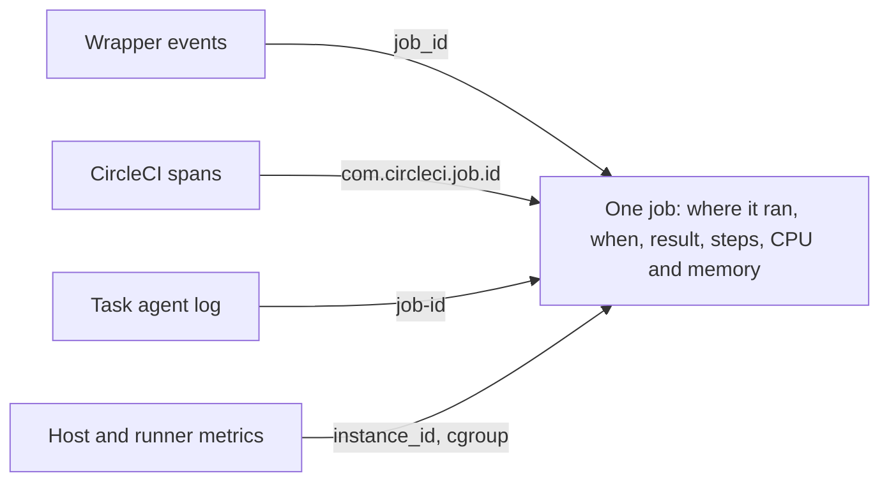

CircleCI's own OpenTelemetry job, step and task spans carry `com.circleci.resource.class` and `com.circleci.job.status`, but no runner or host identity. They are sent when each job finishes. The wrapper and the host agents add the where and the live view. Everything joins on a few keys: `job_id`, `trace_id` (the pipeline ID without dashes, the trace ID of the spans), `instance_id` and `cgroup`. The [end-to-end guide]() shows how to turn the export on.

| Source | Carries | Join key |
|---|---|---|
| Wrapper events (`jobs.jsonl`) | `job_id`, `workflow_id`, `instance_id`, `runner_name`, `resource_class`, start and end | `job_id` = `CIRCLE_WORKFLOW_JOB_ID` |
| CircleCI spans (OTLP exporter) | Job result (`com.circleci.job.status`), resource class, step spans and durations | `com.circleci.job.id` = `job_id` |
| Host metrics (Alloy unix exporter, textfile busy gauge) | CPU, memory, disk, network, busy or idle per runner | `instance_id` label |
| Task-agent journal (optional, experimental) | Step start and end, the job result as the host sees it, in near real time | `job-id` = `job_id`, plus `instance_id` |

To receive the spans, add an exporter in the organization settings or with CircleCI's exporter API (`POST /api/v2/otel/exporters`). See [Set it up end to end]() for the UI and API steps, and [Ship with Grafana Alloy]() for a worked example, and CircleCI's documentation for the current API.
